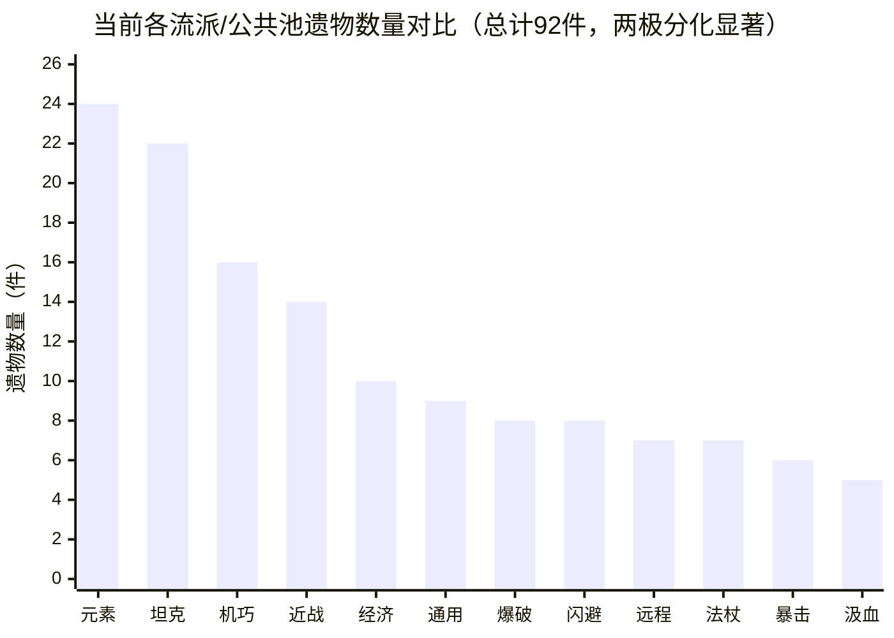

# 《烬塔残响》全流派兵装与装备盘点 · 对标《土豆兄弟》差异调研与下一步扩充建议

> [!IMPORTANT]
> **核心诊断结论**：当前版本共有 **36 把兵装** 与 **92 件遗物装备**。通过全量词条与标签矩阵审计可以清晰看到你直观感受到的两个痛点：
> 1. **流派贫富差距悬殊**：`元素流 (24件)`、`重装坦克流 (22件)`、`机巧建筑流 (16件)` 体系饱满；但 **`物理远程流 (仅7件，T4传说为0)`**、**`汲血续航流 (仅5件，T4传说为0)`**、**`暴击流 (仅6件)`**、**`闪避移速流 (仅8件，缺移速/闪避转输出核心)`** 严重缺件，难以独立成型通关高厄度（D4/D5）。
> 2. **公共与经济池偏薄且 T1/T3 断档**：`通用+经济` 公共池合计仅 **18 件（占 19.6%）**，其中 **T3 紫色品质经济遗物为 0 件、通用仅 1 件**；同时 T1 白装总数仅 24 件，导致前 4 层行商刷新体感重复率高，缺少《土豆兄弟》经典的「加怪换资源」「存钱转属性」「血包爆破」「站桩/移动博弈」等高趣味公共核心。

---

## 一、 当前各流派武器、装备与公共池全量盘点（v2.1.13 实测数据）

### 1.1 兵装池分布（共 36 把：近战 11 把 · 物理/能量远程 21 把 · 秘术法杖 4 把）

| 套装羁绊 | 羁绊激活阶梯 | 数量 | 近战 | 远程 | 法杖 | 当前包含兵装清单 | 结构诊断 |
| :--- | :---: | :---: | :---: | :---: | :---: | :--- | :--- |
| **🌿 古誓 (`primitive`)** | `2 / 4 / 6` 把 | **5** | 3 | 2 | 0 | 守誓残杖、镇塔碑石、银月长枪、回响灵石索、风语毒羽筒 | ⚠️ **上限需 6 把但池内仅 5 把**，缺 T2+ 高阶古誓主C武器 |
| **🎯 星芒 (`precise`)** | `2 / 3 / 5` 把 | **6** | 3 | 3 | 0 | 泣血短刃、白狐裂影爪、绯红断刃太刀、观星猎魔弩、苍翠旋风翎、贯星裁决狙 | ✅ 远近均衡，手感扎实，但**配套暴击遗物过少（仅 6 件）** |
| **🔫 封魂铳 (`gun`)** | `2 / 4 / 6` 把 | **5** | 0 | 5 | 0 | 封魂短铳、六道断罪轮、疾风连发铳、余烬散弹铳、裂魂爆破铳 | ⚠️ **上限需 6 把但池内仅 5 把**，且远程专属 T4 遗物为 0 |
| **🛡️ 黑曜重装 (`heavy`)** | `2 / 3 / 5` 把 | **5** | 2 | 3 | 0 | 碎星重锤、黑曜棱刺盾、余烬榴弹炮、钟楼六管机炮、陨星重炮 | ⚖️ 数量适中，护甲/生命联动完整，爆破分支遗物偏少 |
| **🔥 四象元素 (`elemental`)** | `2 / 3 / 5` 把 | **9** | 1 | 5 | 3 | 劫火紫电刃、碎冕寒冰棱、魂灯贯日束、红莲提灯火、伽蓝紫电弧、日蚀黑阳球 + **赤烬魂灯杖、永冻星辉杖、紫电星轨杖** | 🔥 **第一大户（占全武器 25%）**，法杖重做为火球/暴风雪/连锁闪电后体验极佳，但**近战元素仅 1 把** |
| **⚙️ 发条机巧 (`tech`)** | `2 / 3 / 5` 把 | **6** | 2 | 3 | 1 | 黄金发条扳手、星晷磁暴针、发条连射钉铳、浮游魂灯枢、逆钟磁轨炮 + **发条共鸣法杖（毒雾）** | ✅ 炮台/激光塔/星雷/图腾四类召唤物齐全 |

---

### 1.2 遗物装备池全流派与品质矩阵（共 92 件）

目前 92 件遗物按品质分布为：**T1 普通 `24` 件 · T2 精良 `28` 件 · T3 史诗 `25` 件 · T4 传说 `15` 件**。

| 流派 / 池子标签 | 总件数 | 单标签独占数 | T1 (白) | T2 (蓝) | T3 (紫) | T4 (金) | 流派完整度与核心痛点诊断 |
| :--- | :---: | :---: | :---: | :---: | :---: | :---: | :--- |
| **🔥 元素流 (`elemental`)** | **24** | 5 | 3 | 8 | 10 | 3 | 🟢 **最充沛**（灼烧/冰封/剧毒/元素暴击/四象聚变齐全） |
| **🛡️ 重装坦克 (`tank`)** | **22** | 9 | 6 | 8 | 5 | 3 | 🟢 **最稳健**（护甲、再生、护盾、反伤、血/甲/再生转伤齐全） |
| **⚙️ 机巧建筑 (`tech`)** | **16** | 7 | 3 | 5 | 6 | 2 | 🟢 **体系成熟**（炮台攻速、暴击、元素继承、双传说核心齐全） |
| **⚔️ 近战流 (`melee`)** | **14** | 2 | 4 | 3 | 5 | 2 | 🟡 **中上可用**（有破甲、范围斩波、狐月鞘斩弹，但纯近战独占仅 2 件） |
| **💰 经济成长 (`econ`)** | **10** | 8 | 6 | 2 | **0** | 2 | 🟠 **中段断档**：T1 集中了 6 件，**T3 紫色品质为 0 件**，缺打钱转化输出手段 |
| **🌐 公共通用 (`general`)** | **9** | 4 | 2 | 2 | **1** | 4 | 🟠 **严重偏薄**：全游戏纯通用装仅 9 件，T1/T2 各仅 2 件，过渡选择少 |
| **🧨 爆破流 (`explosive`)** | **8** | 1 | 1 | 4 | 2 | 1 | 🟠 **依附元素**：独占仅 1 件（`赤金裂塔火核`），缺纯物理爆破与连锁炸弹 |
| **🍃 闪避移速 (`dodge`)** | **8** | 3 | **1** | 4 | **1** | 2 | 🔴 **缺输出闭环**：堆满 80% 闪避与高移速后**没有「移速转伤 / 闪避转攻速」**，打不动高层首领 |
| **🪄 秘术法杖 (`staff`)** | **7** | **0** | 1 | 2 | 3 | 1 | 🟠 **零独立件**：7 件全部与 `elemental`/`tech` 绑定，缺法术领域扩域/双倍施法专属件 |
| **🔫 物理远程 (`ranged`)** | **7** | 6 | **1** | 3 | 3 | **0** | 🔴 **重灾区**：15 把物理枪弩对应仅 7 件遗物！**T1 仅 1 件、T4 传说 0 件**！ |
| **🎯 星芒暴击 (`crit`)** | **6** | 2 | **1** | 2 | 2 | 1 | 🔴 **重灾区**：T1 仅 1 件 `星瞳棱镜片`，缺暴击回血、暴击爆金币、暴击削血核心 |
| **🩸 汲血续航 (`vampire`)** | **5** | 3 | **1** | 2 | 2 | **0** | 🔴 **最弱流派**：全池仅 5 件且 **T4 为 0**，受内置汲血冷却限制后既无爆发回复也无吸血转伤 |

---

## 二、 《土豆兄弟》(Brotato) 全装备体系调研与核心差异分析

原版《土豆兄弟》（含本体 ~165 件装备及 *Abyssal Terrors* 深渊 DLC 共 240+ 件装备）之所以百玩不厌、任何流派都能爽玩，核心在于**金字塔型公共池**与**跨维度转化引擎**。对比本游戏，主要存在以下 **6 大结构性差异**：

### 1. 装备总量与「品质金字塔」结构差异
* **《土豆兄弟》**：严格遵循 **正金字塔分布**（T1 白装约占 **34%**、T2 蓝装 **30%**、T3 紫装 **21%**、T4 红装 **15%**）。前 5 波依靠海量廉价且带小负面词条的 T1 白装（如咖啡、温和外星人、袋子、透镜、奇怪的书、香肠、小蛇、树苗）快速定型。
* **《烬塔残响》现状**：`24 : 28 : 25 : 15` 呈**扁平桶状**。T1 白装甚至比 T2、T3 还少！而且 T1 中 `远程/暴击/闪避/汲血/爆破/法杖` **每个流派只有区区 1 件白装**，导致开局前几波很难刷到对口组件。

### 2. 公共池的「风险收益博弈（正负词条交换）」深度差异
* **《土豆兄弟》**：公共装极少无脑全加，而是通过**精准牺牲无用属性换取超模收益**，让不同流派抢着买不同的公共装：
  * **温和外星人 (Gentle Alien, T1)**：`+2 生命, +5% 全伤, 怪物数量 +5%` —— 表面增难，实则**怪多 = 晶石与经验暴涨**，全流派 T0 神装；
  * **玻璃大炮 (Glass Cannon, T2)**：`+25% 全伤, -3 护甲` —— 远程/闪避流狂喜；
  * **重型弹药 / 肌肉男**：牺牲范围换巨额近战，或牺牲近战换巨额远程；
  * **埃斯蒂的沙发 (Esty's Couch, T4)**：每有 `-1% 移速` 转化为 `+2 生命再生`，直接开辟「负移速站桩流」。
* **《烬塔残响》现状**：公共池（`general` 9件 + `econ` 10件，去重 18件）偏少且大多温和，缺少**主动加怪刷钱装**、**站桩流核心装**、**负属性反转神装**。

### 3. 「非输出属性 → 战斗力」跨界转化引擎缺失一半
《土豆兄弟》最令人上瘾的爽点是**把防御/功能属性变成毁天灭地的输出**。对标如下：

| 跨界转化维度 | 《土豆兄弟》代表装备 | 《烬塔残响》现状 | 差距评估 |
| :--- | :--- | :--- | :---: |
| **生命值 → 伤害 / 弹幕** | 异形之眼 (Alien Eyes)、巨人腰带 | ✅ 已有 `不灭熔炉魔心` (HP转全伤) | 已具备 |
| **护甲 → 伤害** | 尖刺盾、重甲转化 | ✅ 已有 `断罪黑曜重铠` (护甲转全伤) | 已具备 |
| **生命再生 → 伤害** | 腐烂躯体 / 医疗转化 | ✅ 已有 `棘血共生魔核` (再生转全伤) | 已具备 |
| **攻击范围 → 伤害** | 狙击手 / 鹰眼转化 | ✅ 已有 `永冻观星披风` (范围转全伤) | 已具备 |
| **移动速度 → 全体伤害** | ⚡ **发电机 (Power Generator, T3)**：每 1% 额外移速 +1% 伤害 | ❌ **完全缺失** | **急需补齐（拯救闪避移速流！）** |
| **闪避率 → 攻击速度** | 🧥 **连帽衫 (Retromation's Hoodie, T4)**：每 1% 闪避 +2% 攻速 | ❌ **完全缺失** | **急需补齐（青羽闪避流毕业核！）** |
| **存留金币 → 最大生命** | 🧱 **衬垫 (Padding, T2)**：每持有 80 材料 +1 最大生命 | ❌ **完全缺失** | **急需补齐（利息屯钱流核心！）** |
| **暴击 → 经济产钱** | 🏆 **狩猎战利品 (Hunting Trophy, T3)**：暴击 33% 概率获 1 材料 | ❌ **完全缺失** | **急需补齐（暴击流滚雪球引擎！）** |
| **幸运 → 拾取轰炸** | 🐘 **小象 (Baby Elephant) + 幸运硬币** | 🟡 仅有 `共鸣紫电珠` 固定概率落雷，不吃幸运数值成长 | **建议强化幸运倍率联动** |
| **砍树/破器物 → 召唤炮台** | 🏭 **口袋工厂 (Pocket Factory, T2)**：击破树木直接生成炮台 | ❌ **完全缺失**（`守林人斗篷` 仅加器物数） | **急需补齐（机巧+砍树联动神装！）** |

### 4. 「血包消耗品流 (Consumable Build)」完全空白
* **《土豆兄弟》**：拥有完整「果园血包流」—— **柠檬水/怪异幽灵/酸液果** 提高血包治疗与爆率，**辣酱 (Spicy Sauce)** 捡血包时按最大生命值引发大爆炸，**折磨/悲伤番茄** 开局半血直接吸地上的血包清屏。
* **《烬塔残响》现状**：后期（10层+）刚刚下调了血包爆率，但装备池里几乎没有围绕「拾取魂血瓶触发增益/爆破/护盾」或「产出魂血瓶灵树（类花园 Garden）」的遗物。

### 5. 物理远程流与汲血流的「机制级核心」断层
* **物理远程流**：《土豆兄弟》有 **弹链/南瓜 (穿透不衰减)**、**狙击镜**、**分裂弹室 (+投射物数量，减单发伤)**、**重型枪管**、**加特林机魂** 等大量 T1~T4 专精件；我们目前 `ranged` 只有 7 件且 **0 件 T4 金装**，拿 6 把封魂铳到后期没有专属传说质变装。
* **汲血流**：《土豆兄弟》有 **献血 (Blood Donation：每秒自扣 1 血换 +40 收获，且自扣血能高频触发受击反伤/狂暴)**、**血手 (Bloody Hand：每 1% 生命窃取提供 +2% 全伤，每秒扣 1 血)**、**吸盘/触手**；我们目前给生命窃取加了内置冷却后，没有给汲血流补上「吸血转全伤」与「溢出治疗转血盾」的 T3/T4 大核，导致汲血流既肉不住也打不出伤害。

---

## 三、 下一步武器与装备优化扩充建议方案

建议下一步开启一次专项 **「军械库与流派补完版本」**：将武器从 **36 把扩充至 42 把（+6 把）**，将遗物装备从 **92 件扩充至 138 件（+46 件）**，彻底消灭弱势流派断档。

### 3.1 武器池补强建议（新增 6 把，精准填平羁绊缺口）

1. **🌿 古誓套装（5 → 6 把，补齐 6 古誓满羁绊）**：
   * 新增 **【苍骨回旋战刃】（近战/投掷混合，T2+）**：挥砍同时掷出回旋古骨巨刃来回切割两次，受最大生命与近战双加成，填补古誓缺少中高阶主 C 的空白。
2. **🔫 封魂铳套装（5 → 6 把，补齐 6 封魂铳满羁绊）**：
   * 新增 **【断界三连脉冲步铳】（远程，T2+）**：精准高速三连发点射步枪，同目标连续命中第 3 发触发破甲贯穿爆头，填补短铳与重狙之间的中流砥柱。
3. **🛡️ 黑曜重装套装（5 → 6 把）**：
   * 新增 **【黑曜链枷流星锤】（近战范围重武，T1+）**：围绕自身大半径横扫圆周的沉重铁链流星锤，享受【护甲 + 爆破范围】双重增幅。
4. **🪄 秘术法杖谱系（4 → 6 把，拓展非元素系秘法流派）**：
   * 新增 **【猩红渴血魔杖】（法杖 · 汲血/星芒跨界，T1+）**：施放【鲜血虹吸法阵】，持续抽取范围内群怪生命转化为自身治疗与血爆新星（直接盘活汲血法术流！）；
   * 新增 **【星蚀引力权杖】（法杖 · 爆破/古誓跨界，T2+）**：在敌群中心召唤小型【微缩黑洞奇点】，把周围散怪强力聚拢一团后坍缩引爆（与火球炎海/暴风雪形成绝配聚怪连招！）。
5. **🎯 星芒 / 🍃 疾风跨界（6 → 7 把）**：
   * 新增 **【追风双弦猎弓】（远程 · 星芒，T1+）**：移动速度越快拉弓射速越快、暴击率越高，为闪避移速流提供一把本命远程主武器。

---

### 3.2 遗物装备池扩充建议（新增 ~46 件，重点扶植 5 大弱势流派 + 公共博弈池）

目标品质配比调整为健康的金字塔结构：**`T1: 42 件 (+18) | T2: 40 件 (+12) | T3: 34 件 (+9) | T4: 22 件 (+7)`**。

#### A. 公共通用 & 经济博弈池（建议新增 12 件，大幅提升每局构筑变数）
* **[T1] 招魂引厄铜铃**（对标 *温和外星人*）：最大生命 +5，全体伤害 +8%，**每波刷怪数量 +6%**（怪多钱多经验多，滚雪球神装，叠加上限 5）。
* **[T1] 青羽行商布袋**（对标 *袋子 Bag*）：每次拾取或结算开启秘匣时，额外直接获得 **+15 封魂晶石**，移速 -1%。
* **[T1] 苦修裂纹瓷面**（对标 *玻璃大炮雏形*）：全体伤害 +18%，攻击速度 +6%，护甲 -2。
* **[T1] 贪婪聚宝瓮**：收获 +6，拾取范围 +35，战斗中每拾取 25 枚晶石额外回复 1 点生命。
* **[T2] 金丝藏晶衬垫**（对标 *衬垫 Padding*）：最大生命 +6；**每持有 60 枚未花费封魂晶石，动态提供 +1 最大生命**（配合金冕利息流绝配！）。
* **[T2] 守夜石像鬼雕纹**（站桩流核心）：**站立不动超过 0.5 秒时**，获得 +28% 攻击速度与 +4 护甲；移动时移速 -4%。
* **[T2] 赤椒炼金火油**（血包爆破流）：魂血瓶治疗量 +3；**每次拾取魂血瓶时，以自身为中心引爆相当于 220% 最大生命值的烈焰冲击波**！
* **[T2] 翠微灵果盆栽**（对标 *花园 Garden*）：每波在战场生成 1 株【治愈灵果树】，每隔 11 秒自动结出 1 枚魂血瓶！
* **[T3] 苦修献祭荆棘冠**（对标 *献血 Blood Donation*）：**收获 +28**；战斗中每秒受到 1 点无视护甲的微弱自损（不会致死，但**可主动触发棱刺反伤、狂暴与受击特效**！）。
* **[T3] 贪婪黄金天平**：每拥有 15 点【收获】，额外转化为 +4% 全体伤害与 +2% 攻击速度（让前期攒的收获在 12~16 层首领战转化为实打实的战力！）。
* **[T3] 命运轮盘赌筹**：幸运 +18；行商刷新时有 25% 概率本次刷新免费，且每 8 点幸运提供 +1% 暴击伤害。
* **[T4] 逆命双生沙漏（传说·唯一）**：全体兵装槽上限 **+1 把**（6槽变7槽！），全体伤害 -6%，攻速 +10%。

#### B. 物理远程流专项补强（`ranged`：7 件 → 15 件，补齐 T1 与 T4 传说大核！）
* **[T1] 刻痕破甲弹芯**：远程伤害 +14%，投射物飞行速度 +15%，近战伤害 -8%。
* **[T1] 轻型速射弹匣**：远程伤害 +9%，攻击速度 +9%，最大生命 -3。
* **[T2] 膛线稳固托架**：攻击范围 +55，远程伤害 +14%，投射物击退力度翻倍（防止快攻怪贴脸）。
* **[T2] 贯通钨芯箭簇**：穿透伤害衰减清零（穿透后续目标造成 **100% 全额伤害**，甚至递增 +8%），远程伤害 +12%。
* **[T3] 分裂幻影弹巢**：所有非光束远程兵装每次射击 **35% 概率额外多射出 1 枚同向魂弹**，远程伤害 +15%。
* **[T3] 鹰眼死神呼吸**：距离自身 220 以外的敌人受到的远程伤害提升 +28%，击杀远端敌人 20% 概率返还瞬步冷却 0.6s。
* **[T4] 万铳神机·无限弹链（传说·唯一）**：**所有远程兵装单次齐射弹丸数 +1**，远程伤害 +24%，攻击速度 +15%，暴击率 -5%！
* **[T4] 贯星天穹轨道镜（传说·唯一）**：远程伤害 +38%，攻击范围 +120；所有远程投射物获得 **+2 穿透与 +1 弹射**，且命中首领附加破甲印记！

#### C. 星芒暴击流专项补强（`crit`：6 件 → 12 件，打通暴击打钱与暴击斩首闭环）
* **[T1] 狐牙锋锐挂坠**：暴击率 +7%，移动速度 +4%，护甲 -1。
* **[T1] 弱点解剖图谱**：暴击率 +5%，暴击伤害 +22%，对精英与首领暴击率额外 +6%。
* **[T2] 处决者染血钩**（对标 *触手 Tentacle*）：暴击率 +6%；**暴击命中时 25% 概率直接恢复 2 点生命**（独立于吸血词条，暴击流专属续航！）。
* **[T3] 猎魔金羽战利品**（对标 *狩猎战利品 Hunting Trophy*）：暴击率 +8%；**每次打出暴击时有 30% 概率直接爆出 1 枚封魂晶石**（每波上限 35 枚）！
* **[T3] 弑巨星芒重腰带**（对标 *巨人腰带 Giant Belt*）：暴击伤害 +40%；**暴击命中时额外附带目标当前生命值 4%（首领为 1.2%，有单次上限）的真实切割伤害**！
* **[T4] 百步穿杨·星神之瞳（传说·唯一）**：暴击率 +18%；**溢出的暴击率（超过 100% 部分）按 1:2.5 全额转化为暴击伤害**，且暴击必触发 1 次星芒连锁弹射！

#### D. 闪避与疾风移速流专项补强（`dodge`：8 件 → 14 件，补齐移速/闪避转输出双引擎！）
* **[T1] 风行草叶符**：闪避率 +6%，移动速度 +6%，最大生命 -3。
* **[T1] 残影轻纱腕**：闪避率 +5%，攻击速度 +7%。
* **[T2] 幻影肾上腺针**（对标 *肾上腺素 Adrenaline*）：闪避率 +6%；**每次成功闪避敌人攻击或弹幕时，50% 概率立即恢复 4 点生命**！
* **[T3] 疾风超导发条炉**（对标 *发电机 Power Generator*）：移动速度 +10%；**每拥有 1% 额外移动速度加成，直接转化为 +1.2% 全体伤害**（跑得越快输出越爆炸！）。
* **[T3] 幻步反击风刃**：闪避率 +7%；每次成功闪避时，自动向周围最近的 3 名敌人齐射高伤穿透苍岚风刃（受移速与暴击加成）！
* **[T4] 青羽的暗影连帽衫（传说·唯一）**（对标 *Retromation's Hoodie*）：闪避率 +8%；**每拥有 1% 闪避率，直接提供 +1.6% 攻击速度**（80% 闪避 = **+128% 狂暴攻速**，彻底解决青羽后期刮痧问题！）。

#### E. 汲血猩红流专项补强（`vampire`：5 件 → 11 件，补齐吸血转伤与血盾质变）
* **[T1] 渴血荆棘指环**：生命窃取 +4%，近战与远程伤害 +8%，每秒生命再生 -0.8。
* **[T2] 猩红狂热血瓶**：生命窃取 +5%；生命值低于 65% 时，攻击速度 +24%、移动速度 +12%。
* **[T2] 嗜血夜鼠笛**（对标 *老鼠 Mouse*）：生命窃取 +5%，**每波怪物数量 +8%**，收获 -4。
* **[T3] 鲜血契约圣印**（对标 *血手 Bloody Hand*）：生命窃取 +6%；**每拥有 1% 生命窃取，直接转化为 +2.2% 全体伤害**！
* **[T4] 绯红真祖圣爵（传说·唯一）**：生命窃取 +10%，汲血内置冷却缩短 **40%**；**满血状态下触发的溢出汲血治疗，100% 转化为可吸收伤害的【猩红血盾】（上限为最大生命值的 35%）**！
* **[T4] 不死鸟涅槃血羽（传说·唯一）**：生命窃取 +8%，全体伤害 +25%；每波首次受到致命伤害时免疫死亡，瞬间回满 50% 生命并清空周围敌弹！

#### F. 秘术法杖独立流 & 机巧爆破跨界补强（新增 8 件）
* **[T1] 秘银聚魔杖环**（`staff` 独占）：【法杖】施法射程 +45，法术领域（火海/暴风雪/毒雾）作用半径 +14%，法杖基础伤害 +12%。
* **[T2] 双生奥术回响石**（`staff` 独占）：【法杖】吟唱冷却缩短 12%，释放地面法术领域时持续时间延长 +0.9 秒。
* **[T2] 随身发条母盒**（对标 *口袋工厂 Pocket Factory*，`tech`+`econ`）：工程伤害 +12%，每波额外生成 +1 座封魂器物；**每次击破场上的封魂器物，直接在原地生成 1 座自律发条机炮塔**！
* **[T3] 以太扩域星盘**（`staff` 独占）：【法杖】所有法术与领域范围扩大 **+28%**，连锁闪电跳跃次数 **+2**，法杖技能每命中 1 名处于领域内的敌人额外增伤 +18%！
* **[T4] 万法归宗·禁忌法典（传说·唯一）**（`staff` 独占）：【法杖】每次施法有 **35% 概率在 0.25 秒后免费双重咏唱再放一次同款大法术**（双发大火球 / 双重暴风雪 / 双连天雷 / 双重毒雾）！

---

### 3.3 商店刷新与隐藏流派匹配微调建议
1. **将 `econ` 经济向与跨属性转换件纳入智能匹配**：当玩家持有高移速时，微幅抬升「移速转伤」权重；当玩家存留大量晶石或带金冕时，微幅抬升「存钱加血衬垫」权重。
2. **前 3 层商店保底公共/经济槽位**：第 1~3 层每次商店刷新的 4 个卡槽中，保证至少有 1 槽优先从「武器或 T1 经济/公共博弈装」中抽取，让开局定流派和滚雪球手感媲美《土豆兄弟》原版节奏。
