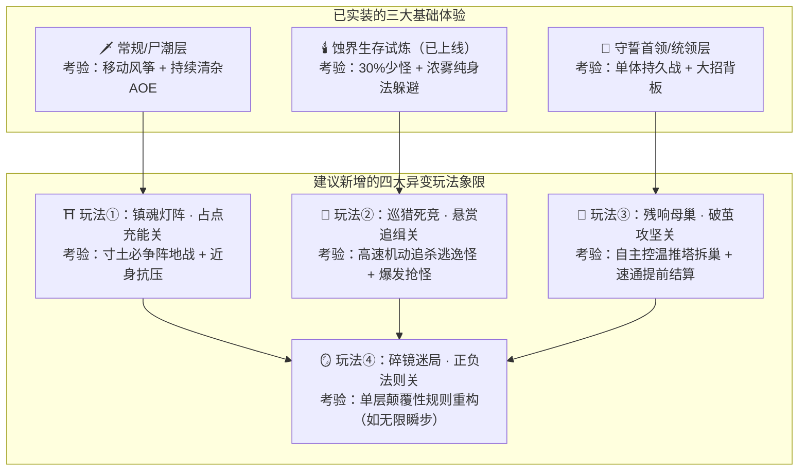

# 《烬塔残响》进阶特殊玩法调研与设计提案（除「生存关」外的多元试炼矩阵）

> 承接 [survival_trial_proposal.md](./survival_trial_proposal.md) 的设计脉络：既然 **「🕯️ 蚀界生存试炼」** 已经把“纯身法穿弹幕”做成了独立高光体验，那么在一局 16 层攀登或无尽轮回中，除了**常规割草层**、**首领战**与**生存躲避关**，还能加入哪些**体感截然不同、且能让不同流派轮流爽起来**的玩法？

---

## 一、竞品标杆调研：主流动作肉鸽如何打破“无限绕圈刷怪”单调感？

在俯视角竞技场肉鸽中，常规波次的最大惯性是 **“绕着地图外墙跑大圈 + 堆全屏 AOE”**。我们横向拆解了 6 款同品类标杆作品的破局玩法：

| 对标作品 | 核心特殊玩法机制 | 颠覆了什么常规习惯？ | 可提炼至《烬塔残响》的核心爽点 |
| :--- | :--- | :--- | :--- |
| **《雨中冒险 2》** *(Risk of Rain 2)* | **传送门充能圈 / 虚空立场驻守 (Holdout Zone)** | 打破“满图乱跑风筝”，强迫玩家在限定光圈内寸土必争地阵地防守 | 让平时吃亏的 **工程炮台流、重甲护盾流、近战横扫流** 迎来绝对主场；充满即提前秒通！ |
| **《哈迪斯 1 & 2》** *(Hades I & II)* | **塔纳托斯/涅墨西斯杀敌竞速**、**虫茧破拆房**、**厄瑞玻斯无伤门** | 从“求稳保命”变成“激进抢怪 / 追杀高价值目标 / 零失误挑战” | 引入 **限时逃逸悬赏怪（盗宝窃魂魔）** 与 **裁决抢怪压力**，让高移速/高爆发流派爽快追猎 |
| **《深岩银河：幸存者》** *(DRG: Survivor)* | **异虫卵囊定点击破 + 空投补给舱读条驻守** | 把“被动熬时间等倒计时结束”变成 **“打完目标立刻提前通关拿大奖”** | **静态高血量母巢破茧玩法**：不打时温和，打碎时喷发弹幕与精英，风险节奏 100% 由玩家掌控 |
| **《土豆兄弟：深渊》** *(Brotato DLC)* | **诱饵 (Bait) 贪婪加怪** + **深渊诅咒正负词条** | 把难度提升直接绑定为玩家主动签下的“暴富契约” | 在风亭商店提供 **因果诱饵** 与 **单层狂野法则词条**（如无限瞬步、血沸双倍吸血） |
| **《咒语旅团》** *(The Spell Brigade)* | **局内限时动态目标（净化腐化点、护送/驻守法阵）** | 在常规刷怪波次中插入 12~15 秒的短平快空间目标，不断切换走位重心 | 在普通层中段穿插非强制的 **15 秒记忆灯芯伴行**，做成加奖、不做不罚 |
| **《墨境》** *(Realm of Ink)* | **天劫谷挑战房 + 洪荒祭坛献祭重铸** | 战斗外提供“以旧换新、跨阶重铸”的构筑博弈房 | 风亭新增 **魂火重铸鼎**，消耗冗余低阶装定向锻造本流派高阶核心遗物 |

---

## 二、核心诊断：《烬塔残响》的六维战斗体验拼图

将现有关卡与待拓展玩法放在同一坐标系下对比，可以清晰看到空白象限：

> [!TIP]
> **零额外 UI 负担的完美接入点**：目前第 1~4 幕的风亭商店已拥有现成的单行契约栏 `#shopTrialBar`（见 [shop.js](../src/ui/shop.js#L1319-L1357)）。如果整局 16 层每次都只弹「蚀界生存试炼」，到第 3、4 幕新鲜感会递减；若将 `#shopTrialBar` 升级为 **「风亭试炼契约台」**——每幕随机/轮换抽出 **生存关、占点关、追缉关、破茧关、法则关** 之一供玩家自愿签署，既 **100% 不改动 16 层主线剧情契约**，又 **完全不增加手机端商店高度**！

---

## 三、方案详解：四大「整层特殊试炼关」（Tier A · 主推）

### 玩法 ①：【⛩️ 镇魂灯阵 · 占点充能关】（阵地防守型）
- **一句话体验**：拒绝绕墙跑大圈！守住三座依次亮起的青焰镇魂阵，**充能越快、通关越早、赏金越高**。
- **核心机制**：
  1. 本层基础上限 `45 秒`，场地内依次激活 **3 座「残响镇魂碑」**（半径约 `115px` 的青金符文圆阵，地面绘制无渐变双环刻度盘）。
  2. **驻守充能**：玩家处于圈内时每秒充能 **`+12.5%`**（单座仅需 **8 秒** 充满）；被迫出圈躲技能时**充能暂停但绝不倒退**（保障手机端触屏容错，不搞恶性回退）。
  3. **满充净空爽点**：每充满 1 座魂碑，魂碑立刻爆发一道 **全屏青焰净魂冲击波**——瞬间震飞并秒杀周围普通小怪、抹除全屏敌方弹幕、爆出一簇封魂晶石与回血球，随后在场地另一侧点亮下一座魂碑！
  4. **提前胜利与阶梯结算**：
     - **3 座全满（最快约 25~28 秒直接提前通关！）**：剩余每秒钟折算额外速通晶石 + 必得 **【镇魂圣匣】（保底紫/金，且工程/护甲/范围类装备权重提升）**；
     - **45 秒到时但未充完 3 座**：同样算存活过关，按已充完的 `1~2 座` 发放对应晶石补贴，零暴毙挫败感。
- **最爽流派**：🔧 **工程炮台/图腾流**（把炮台全架在圈里火力全开）、🛡️ **重甲护盾荆棘流**、❄️ **暴风雪/火海领域法杖流**、⚔️ **大范围近战流**。

---

### 玩法 ②：【🎯 巡猎死竞 · 悬赏追缉关】（高机动追猎型）
- **一句话体验**：生存关的完美反面——不是躲弹幕，而是**化身猎人在全图追杀携款潜逃的「怀金窃魂魔」**！
- **核心机制**：
  1. 本层时长 `35 秒`，常规追击小怪减少 `40%`，不会出现堵路重甲怪。
  2. **逃逸悬赏怪「怀金窃魂魔」**：每隔 `4.5 秒` 从地图边缘裂隙刷出 1~2 只背着金匣的高速窃魂魔（头顶带 `9 秒` 钻洞逃跑倒计时条，屏幕边缘显示金色追缉方向箭头）。它不主动撞玩家，而是绕着地形高速逃跑，并在身后沿途抛洒延时小炸弹阻拦追兵。
  3. **灰塔裁决抢怪压力**（致敬《哈迪斯》塔纳托斯）：场地每隔数秒会降下缓慢缩圈的紫色「灰塔裁决印」秒杀圈内普通怪——**被裁决印抢先杀死的怪不掉晶石**，逼迫玩家主动贴脸抢收人头或专心追砍窃魂魔！
  4. **悬赏阶梯大奖**：
     - 每斩杀 1 只窃魂魔当场喷发大量晶石与加速残影 Buff（移速临时 `+18%` 越追越快！）；
     - 累计斩杀 **≥ 4 只** 解锁【巡猎秘匣】，斩杀 **≥ 6 只** 升级为 **【黄金财神圣匣】+ 下一层商店全场 85 折契约**！
- **最爽流派**：👟 **高移速刺客/闪避流**、🔫 **高暴击狙击远程流**、🪄 **高射程雷电/星界法杖流**。

---

### 玩法 ③：【🥚 残响母巢 · 破茧攻坚关】（自主控温拆塔型）
- **一句话体验**：全场矗立 4~5 座高血量晶茧母巢，**稳扎稳打单拆还是同时引爆三巢狂刷，节奏完全由你决定**！
- **核心机制**：
  1. 本层时长 `45 秒`，取消常规周期刷怪！开场地图四角与中庭生成 **4 座（高厄度 5 座）静态「蚀界晶茧母巢」**。
  2. **自主控温孵化**：未被攻击的母巢处于休眠态，仅每 5 秒缓慢爬出 1 只小怪；一旦某座母巢受到攻击、血量跨过 `66%` / `33%` / `0%` 阈值，会立即触发一次 **破壳狂暴反击**（环形骨刺弹幕 + 刷出 1 只狂化精英护卫）。
  3. **全拆秒通与永久晶核**：
     - 每击破 1 座母巢，原地必爆大额晶石 + **1 枚本局永久微赐福晶核**（如 `全伤+2%` / `攻速+2.5%` / `最大生命+2`）；
     - **45 秒内拆光全部母巢立即提前清场通关**，额外奖励 **【破茧霸主秘匣】**！若输出不够只拆了 2~3 座，倒计时结束依然安全过关拿对应收益。
- **最爽流派**：💥 **高单点爆发近战/重武流**、🔥 **叠毒/叠灼烧持续流**（给多座母巢挂满 DoT）、🔫 **贴脸散弹秒杀流**。

---

### 玩法 ④：【🪞 碎镜迷局 · 单层正负法则关】（狂野规则重构型）
- **一句话体验**：只在这一层生效的 **“神魔双刃剑法则”**，让同一套装备打出完全超模的爽快异变！
- **核心机制**：签订契约前，商店契约栏会**明牌展示本层随机抽出的 1 条正负法则**（玩家看契合度自由决定签不签），撑过本层必得【碎镜秘匣】：
  - **法则 A ·「瞬影无双」**：本层所有武器冷却延长 `35%`，但 **青焰瞬步 CD 缩短至 `0.85 秒`**，且每次瞬步触发的职业战技伤害与范围 **翻倍（`×220%`）**——全图无限瞬步轰炸！
  - **法则 B ·「血沸狂宴」**：本层每秒流失 `3.5%` 当前生命且禁用自然回血，但 **生命偷取与拾取血包治疗量 `×250%`、全体伤害 `+45%`**，且每只小怪死后原地引爆伤敌血雾（连环清屏）！
  - **法则 C ·「巨像猎场」**：本层怪物总数量减少 **`65%`**，但刷出的每一只怪全部体型放大 `1.35x`、100% 携带狂化精英词缀，且**单怪掉落晶石 `×300%`**！
  - **法则 D ·「无瑕冥狱」**（厄瑞玻斯门）：本层玩家造成伤害 **`+75%`**，若整波 **受击次数 = 0**，通关直接白嫖一件高阶遗物；一旦受击 1 次则额外秘匣碎裂（保留常规晶石收入）。

---

## 四、补充调研：三类「轻量穿插 / 风亭整备」微玩法（Tier B · 低成本高趣味）

如果不替换整层关卡，也可以在**现有常规波次中段**或**风亭整备界面**加入以下轻量级玩法调剂：

1. **【🏮 迷途灯芯 · 15秒伴行微事件】（常规波次中段随机奇遇）**
   - 在第 2~15 层常规波次第 `14 秒` 概率触发：一枚不可被怪物摧毁的「迷途记忆灯芯」浮现，玩家只需**站在灯芯周围小圈内伴行 `7~8 秒`** 将其引渡至终点裂隙（绝无传统护送NPC暴毙的血压感！），即可当场引爆全场清屏震波，并获得 **1 次免费商店刷新 + 晶石福袋**；不想护送也完全不影响正常刷怪。
2. **【🥩 蚀影诱饵契】（风亭商店高风险理财道具 · 致敬《土豆兄弟》鱼饵）**
   - 商店概率刷出 **0 元购甚至倒贴 `+12💎`** 的特殊消耗品【蚀影诱饵】：买下立刻加属性（如 `+8%全伤`），代价是下一层开场额外涌出一批高速精英猎犬——让高手玩家能主动“贷款加怪换发育”。
3. **【⚗️ 青羽魂火重铸鼎】（风亭整备构筑救济）**
   - 每幕可使用 1 次：投入 `2 件同品质闲置遗物`（或消耗少量晶石重锻当前一把低阶武器），定向转化为 **1 件高一阶且契合当前最高流派倾向的核心装备**，大幅提升逆风局翻盘爽感。

---

## 五、技术与手机端适配评估（100% 契合现有架构）

| 评估维度 | 兼容性结论 | 具体保障措施 |
| :--- | :--- | :--- |
| **16 层主线叙事契约** | ✅ **零侵入** | [story-v2.js](../src/data/story-v2.js) 与第 `4/8/12/16` 首领层、第 `6/10/14` 统领层完全不动；所有特殊关仅挂载于常规层契约槽。 |
| **手机端一屏商店布局** | ✅ **零增高** | 直接复用现有 `#shopTrialBar` 单行契约条（或提供左/右小箭头在 2 种契约间切换），不破坏手机端 2×2 货架一屏免下拉。 |
| **手机端渲染帧率红线** | ✅ **0 实时渐变 / 0 阴影** | 镇魂阵圆环、母巢晶茧、窃魂魔悬赏标均采用预烘焙 `vfxSprites` 辉光 + 纯几何矢量绘制，严守 `renderer.js` 高帧率规范。 |
| **手机端平衡适配** | ✅ **原生继承 `v2.1.21` 系数** | 自动继承 `MOBILE_MOB_COUNT_MUL (0.80)` 与 `MOBILE_GOLD_YIELD_MUL (1.20)`，且占点圈半径在触屏端适度放宽 `+12%` 提升手感。 |

---

## 六、开发优先级建议与待确认决策

如果要挑 **1~2 个最先落地实装**，与现有的「🕯️ 蚀界生存关」组成体验反差最大的黄金三角，推荐优先级如下：

1. **首选推荐：【⛩️ 镇魂灯阵 · 占点充能关】 + 【🎯 巡猎死竞 · 悬赏追缉关】**
   - 三者正好构成 **「纯躲避（生存关） ↔ 守阵地（占点关） ↔ 追目标（追缉关）」** 的完美三角互补，且能把 `#shopTrialBar` 升级为每幕随机刷新不同试炼契约！
2. **次选高爽感：【🥚 残响母巢 · 破茧攻坚关】** 或 **【🪞 碎镜迷局 · 正负法则关】**。
3. **风亭小系统：【🥩 蚀影诱饵】 / 【⚗️ 魂火重铸鼎】**。
