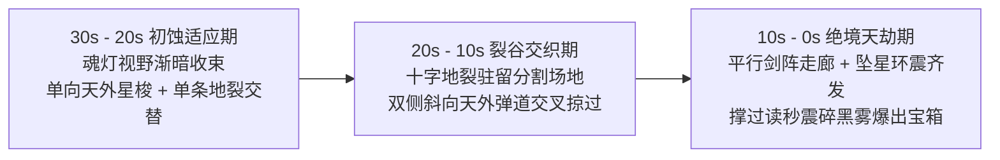

# 「蚀界渡劫 · 30秒绝境生存关」调研与设计方案

## 一、竞品机制调研与核心可借鉴点

围绕你的构想（**天外弹道 + 地形裂缝 + 怪物仅保留 30% + 视野缩减 + 坚持 30 秒纯躲避**），我们对 **《咒语旅团》(The Spell Brigade)** 与 **《墨境》(Realm of Ink)** 进行了针对性拆解：

| 维度 | 《咒语旅团》(The Spell Brigade) | 《墨境》(Realm of Ink) | 对《烬塔残响》的提炼与转化 |
| :--- | :--- | :--- | :--- |
| **核心生存/试炼形态** | **时间轴动态事件与天降轰炸**：在常规刷怪流中穿插限时区域目标（封印裂隙、驻守法阵）与流星雨/环境龙卷轰炸，迫使玩家放弃站桩持续跑动。 | **「天劫谷」限时坚持房 & 机关密室**：独立的高压渡劫挑战房，要求在限定读秒内纯靠走位与冲刺躲避密集剑阵、激光突刺与机关弹幕，撑完读秒直接开大宝箱。 | 在常规割草波次之间插入 **30 秒高浓缩“渡劫节奏变换器”**，从“拼火力清屏”切换为“纯身法穿针引线”，大幅缓解连续刷怪的审美疲劳。 |
| **天外弹幕与地形切割** | 流星陨落、冰原滑冰/深渊岩浆地标与敌群弹幕形成复合封路，考验移动速度与提前量预判。 | **剑阵辐射与时空裂缝**：大范围纵横剑气走廊与地面裂隙陷阱先亮起清晰红线/水墨轨迹，再高速斩落，留出精准走位与冲刺横跨的安全缝隙。 | 结合灰塔四幕生态，设计 **屏外贯穿弹道（天外飞剑/星梭）** 与 **持续驻留的地面裂谷（十字/折线地裂）**，先切割走位空间，再用天外弹道逼迫位移。 |
| **视野受限机制** | 暗黑主题/黑暗元素压制视距，远端敌情不可见，玩家需贴近自身法术光源并紧盯近身预警圈反应。 | **迷雾房与「画地为牢」视野圈限制**：水墨浓雾遮蔽外围视线或限制安全圈，但**地面陷阱红线与亮色水墨预警始终高对比可见**，杜绝无预警黑枪。 | 完美契合主角零手中的 **「青焰魂灯」**！浓雾锁死外围视野，仅保留周身提灯照明圈；但**灯圈边缘必须有来袭弹道预警刻标**，确保零无敌帧下绝对公平。 |
| **少怪期的收益闭环** | 完成局内限时事件直接发放法术附魔/进化与团队强化，弥补做任务期间少刷怪的经验损失。 | 撑过天劫谷倒计时后，场地中央立即解锁 **丰厚渡劫宝箱（银币+丹药+高阶墨宝）**，风险与收益高度成正比。 | 怪物削减至 **30%** 会少掉 70% 晶石，必须由 **通关晶簇爆发 + 渡劫秘宝箱（无伤/少伤升级品质）** 补齐并超额回馈！ |

---

## 二、《烬塔残响》30秒生存关整体设计方案

### 1. 关卡定位与触发方式（不破坏 16 层主线叙事契约）

目前 [spawner.js](../src/game/spawner.js#L1120-L1130) 的 16 层主线结构中：
- **第 `4 / 8 / 12 / 16` 层**：固定四幕主线首领战（绑定 [story-v2.js](../src/data/story-v2.js) 剧情演出与信物）；
- **第 `6 / 10 / 14` 层**：固定精英副官战（`isEliteWave`）；
- **其余常规/尸潮层**：`1, 2, 3, 5, 7, 9, 11, 13, 15`。

为了 **100% 不改动总层数（16层）与主线剧情触发**，提供以下三种接入方案供选择：

- **方案 A（推荐 · 风亭整备「主动渡劫裂隙」可选挑战）**：
  - 类似《墨境》进入天劫谷的自主抉择：在每幕中段的商店整备界面（如准备进入 **第 3、7、11、15 层** 或 **第 5、9、13 层** 前），底部出现一枚闪烁紫青火光的 **【⚡ 踏入蚀界试炼（30秒绝境躲避 · 额外秘宝箱）】** 开关按钮。
  - **优点**：玩家拥有完全主动权！状态好、想搏高阶宝箱或想爽快秀身法时主动开启；残血求稳时可正常打常规波次，零挫败感。
- **方案 B（流程内嵌 · 每幕固定/随机 1 层变为生存试炼）**：
  - 主线在第 2~4 幕的非首领、非副官层（例如 **第 5、9、13 层**，或每幕从 `{2,3}` / `{5,7}` / `{9,11}` / `{13,15}` 中随机抽 1 层，整局共出现 2~3 次）自动触发「蚀界突袭 · 30秒生存关」；无尽模式从第 17 层起每 6 层固定轮换一次。
  - **优点**：每一局攀登都有鲜明的节奏起伏，不需要额外点选 UI。
- **方案 C（混合模式）**：
  - 整局主线固定触发 **1~2 次**（如第 7 层、第 13 层），同时无尽模式与高难模式下可在商店额外主动开启。

---

### 2. 核心战斗规则（严格对齐需求参数）

1. **恒定 30 秒浓缩倒计时**：
   - 在 [spawner.js](../src/game/spawner.js#L1090-L1142) 中，当本波标记为 `survivalTrialWave = true` 时，覆盖 `getWaveDuration(wave)`，强制 `waveTime = 30.0`、`waveMaxTime = 30.0`。倒计时归零即刻触发全场蚀界净空，直接获胜结算！
2. **怪物数量精准压缩至 `30%`（去肉盾化）**：
   - 开场合围怪 `openCnt`、同屏上限 `maxActiveEnemies`（见 [update.js](../src/game/update.js#L833-L835)）以及周期刷怪批次全部乘以 **`0.30`**。
   - **怪池净化**：试炼期间**禁用护盾卫士、重装巨像、自爆虫与精英怪**，仅刷出 30% 的基础轻型追击怪（如追猎傀儡、迅捷残影）。它们既能给轻微走位压力，又能给近战/吸血/杀敌叠层流派充当“移动血包与跳板”，绝不卡位堵路。

---

### 3. 「天外弹道 + 地形裂缝」四重机关矩阵

结合灰塔四幕视觉主题（绯雨断桥剑雨 / 极寒冰窟冰梭 / 倒悬钟楼光矛 / 蚀日圣所黑芒），设计 **4 类高辨识度纯躲避杀招**：

| 机关类型 | 预警表现（公平性保障） | 发作与伤害判定 | 走位博弈体验 |
| :--- | :--- | :--- | :--- |
| **① 天外贯星梭** *(屏外高速直掠弹道)* | 发射前 **`0.75s`** 地面拉出纤细亮色瞄准轨，且在**魂灯视野边缘亮起来袭三角标** | 从地图外侧高速横贯全场（宽 `22px`，移速 `620~760`），单发或 3~5 连排齐射 | 考验横向小碎步微调；刚调整完近战砍弹道几率后，更凸显纯走位避让的刺激感 |
| **② 蚀界大地裂隙** *(驻留型折线/十字地形裂缝)* | 地面先浮现 **`0.85s`** 剧烈震颤的暗红/冰蓝裂纹带（宽 `46px`），伴随低沉地鸣音效 | 崩裂后驻留 **`3.6s`** 的危险裂谷（每 `0.25s` 灼烧/割裂判定 + 18% 微减速），单场最多同时存在 2~3 条 | 动态将场地切割成数块区域，逼迫玩家在安全岛内闪转腾挪，或用 **瞬步（Space/Shift）** 直接飞跃裂缝 |
| **③ 天劫剑阵走廊** *(等距平行网格斩击)* | 横向或纵向同时铺开 4~6 道平行预警光带（预留 **`105px`** 宽安全走廊，预警 **`0.90s`**） | 天外巨剑/轨道光束同步轰落，瞬间结算一次中高额伤害并消散 | 复刻《墨境》经典剑阵房体验——在有限视野内迅速找到安全走廊缺口站位 |
| **④ 终末坠星环震** *(落点陨石 + 环形扩散波)* | 地面亮起坠星双环法阵（预警 **`1.10s`**） | 陨星砸落中心爆炸，并向外扩散一道薄环冲击波或十字裂波（内圈留安全风眼 `innerSafeR`） | 后 10 秒与地面裂缝联动，制造“先躲中心陨石、再反身切入内圈避环波”的高光操作 |

#### 30 秒三段式心流编排

- **防秒杀保护**：参照 [combat.js](../src/game/combat.js#L1117-L1120) 的首领战防猝死机制，生存关内天外弹道与裂缝单次伤害设有上限（单次不超过最大生命值的 `28%~32%`），既紧张刺激，又留有容错空间。

---

### 4. 「青焰魂灯」视野缩减方案（高氛围 + 防黑枪 + 零性能损耗）

> [!IMPORTANT]
> 本项目 [renderer.js](../src/render/renderer.js) 与自动化校验脚本 `tests/verify.mjs` 严禁在渲染循环中使用 `createRadialGradient` 与 `shadowBlur`，且主角零无敌帧（`player.invuln = 0`）。视野机制必须同时满足 **零渐变高性能** 与 **绝无视野外黑枪**！

1. **视觉与世界观融合**：
   - 开场前 `1.2s`，四周蚀界浓雾向内合拢，主角零周身亮起温暖而凌厉的 **青焰魂灯照明圈**（建议基础可视半径 **`265px`**，约保留屏幕 **42%~48%** 的核心视野；外围笼罩约 `85%` 不透明度的深墨蓝暗雾，隐约可见地形大轮廓但看不清远端细节）。
   - **瞬步燃灯交互**：每次释放 **青焰瞬步** 时，魂灯火芯暴涨，照明半径在 `1.1s` 内临时扩张至 **`330px`**，让“主动瞬步”兼具位移躲避与探照视野的双重爽感！
2. **双保险防黑枪设计**：
   - **灯缘来袭罗盘刻标**：任何屏外天外弹道在飞入魂灯照明圈前 `0.75s`，会在魂灯圆周边缘对应角度亮起一枚闪烁的 **琥珀金/绯红小尖碑箭头**（距离越近越亮），玩家看灯圈边缘即可提前横向走位。
   - **地面裂隙微光透雾**：正在蓄力的地面裂缝与剑阵走廊轨迹，在浓雾外仍保留 `30%` 暗色轮廓微光，跨入灯圈后转为 `100%` 锐利高亮，杜绝一脚踏进未知裂缝。
3. **O(1) 零渐变渲染实现**：
   - 波次初始化时一次性生成一张离屏遮罩贴图（用多层同心 `arc` 奇偶环切 `evenodd` 叠加出柔和羽化过渡，**0 次 `createRadialGradient`**），渲染阶段每帧仅需以主角屏幕坐标为中心 `drawImage` 一次 + 四周 4 块纯色 `fillRect` 封边，手机端与 144Hz 桌面端帧率 **0 波动**。

---

### 5. 经济补偿与渡劫奖励设计（解决 30% 怪物导致的发育缺口）

怪物减少 70% 若不补偿，会导致该层晶石收入暴跌。结合《墨境》天劫谷“撑过即富”的爽点，设计 **保底补贴 + 身法评级宝箱**：

1. **蚀界晶簇保底喷发（发育零亏损）**：
   - 30 秒倒计时归零瞬间，所有残余小怪与裂缝瞬间湮灭，玩家身旁自动爆开一座 **「蚀界封魂晶簇」**，直接折算发放 **相当于同层常规满怪波次 95%~105% 期望值的封魂晶石**（计入 [shop.js](../src/ui/shop.js#L379-L388) 的当前波次晶石汇率与收获复利）。
2. **渡劫身法评级奖励（高风险高正反馈）**：
   - **成功存活（保底）**：必掉 **1 个战利品秘宝箱** + 恢复 35% 生命值；
   - **完美/极意渡劫（30 秒内受击 ≤ 2 次，或全程 0 受击）**：战利品箱直接升级为 **【首领级黄金秘宝箱】** 额外加赠一笔赏金晶石（若 0 受击额外再获 `+3%` 永久闪避或移速微赐福，单局上限 2 次）！

---

## 三、待你拍板的 3 个关键设计选项

方案确认后我再开始写代码，请告诉我你更倾向哪一种组合：

1. **触发方式**：
   - **选项 1（商店自选挑战门）**：特定层数商店里出现「踏入蚀界生存试炼」开关，玩家自选进不进（高风险高回报）；
   - **选项 2（流程自动穿插）**：主线非首领层（如第 5 / 9 / 13 层中抽取 2 层，无尽模式周期触发）自动变为 30 秒生存关；
   - **选项 3（两者都要）**：主线固定体验 1~2 次，无尽/商店也可主动开启。
2. **视野缩减强度**：
   - **温和档**：保留约 **50%~55%** 屏幕视野（半径约 `300px`，外围半透明暗雾 `78%` 浓度，压迫感适中）；
   - **沉浸档（推荐）**：保留角色周身 **40%~45%** 魂灯圈（半径约 `260px`，外围浓雾 `86%` 浓度，配合灯圈边缘来袭箭头，氛围感最足）。
3. **渡劫额外奖励**：
   - 是否加入类似《墨境》天劫谷的 **「通关必掉宝箱 + 少受击/无伤升级宝箱品质」** 机制？
